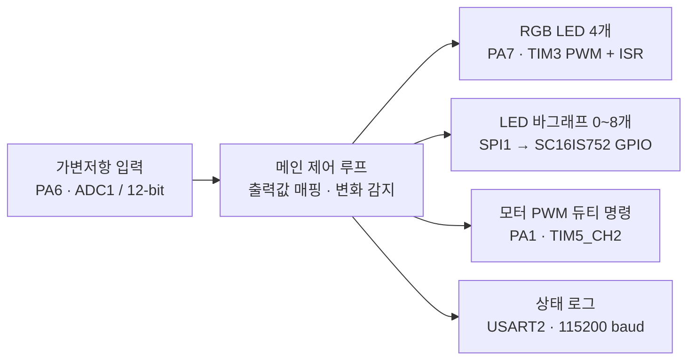

# STM32 ADC 기반 다중 출력 제어

가변저항 입력 하나로 **RGB LED 색상 · LED 바그래프 · 모터 PWM**을 연동하는 STM32F411 베어메탈 프로젝트입니다.

**C / CMSIS · 레지스터 직접 제어 · ADC · Timer PWM / Interrupt · SPI · UART**

## 한눈에 보는 동작



출력값 중 하나라도 달라지면 세 출력을 함께 갱신하고 상태를 UART로 전송합니다.

| 기능 | 구현 내용 |
| --- | --- |
| 아날로그 입력 | ADC1_IN6 단일 변환을 polling으로 읽음: 0~4095 |
| RGB LED | 입력 범위를 무지개 색상환으로 변환해 WS2812B 4개에 같은 색 지정 |
| LED 바그래프 | SC16IS752 GPIO에 active-low 패턴 전송: 0~8개, 총 9개 표시 상태 |
| 모터 출력 | 입력에 비례한 정회전 PWM 듀티 명령 0~100, 설정상 20kHz |
| 상태 확인 | ADC 값, RGB, 바그래프 패턴, 듀티 명령을 UART로 출력 |

아래는 코드 계산식에 따른 예시이며, 실측 결과가 아닙니다.

| ADC | RGB | 바그래프 점등 명령 | PWM 듀티 명령 |
| ---: | --- | ---: | ---: |
| 0 | 빨강 `(255, 0, 0)` | 0개 | 0 |
| 2048 | 청록 `(0, 255, 255)` | 4개 | 50 |
| 4095 | 빨강 `(255, 0, 0)` | 8개 | 100 |

## 핵심 구현

- **입력 하나를 세 출력으로 매핑:** 정수 연산으로 색상환, 반올림한 점등 개수, PWM 듀티 명령을 계산합니다. [main.c](main.c)
- **WS2812B 데이터 직렬화:** LED별 GRB 24비트를 PWM compare 값으로 바꾸고, 별도 전송 버퍼를 TIM3 ISR에서 순차 출력합니다. [ws2812b.c](ws2812b.c) · [exception.c](exception.c)
- **메인 루프와 타이머 연동:** ADC·SPI는 polling으로 처리하고, TIM3은 LED 전송, TIM4는 시간 기준, TIM5는 모터 PWM을 담당합니다. [timer.c](timer.c)

## 빌드 및 다운로드

확인한 환경은 **Windows / Arm GNU Toolchain 15.2.Rel1, GCC 15.2.1 / GNU Make 3.81**입니다. Cortex-M4F, hard-float ABI, `STM32F411xE`를 대상으로 빌드합니다.

1. Arm GNU Toolchain과 GNU Make를 설치하고 실행 파일을 `PATH`에 등록합니다.
2. [Makefile](Makefile)의 `TOOL_DIR`과 `VERSION`을 설치 경로·GCC 버전에 맞춥니다. 현재 기본 경로는 `C:\arm-gnu-toolchain-15.2.rel1-mingw-w64-i686-arm-none-eabi`입니다.
3. 저장소 루트에서 실행합니다. 현재 Makefile은 여러 객체를 한 번에 생성하므로 직렬 빌드를 사용합니다.

```powershell
make -j1
```

생성 파일: `rom_0x08000000.elf`, `rom_0x08000000.bin`, `rom_0x08000000.map`, `__dump.txt`, `__dump_all.txt`

하드웨어가 연결된 환경에서는 STM32CubeProgrammer CLI를 `PATH`에 등록한 뒤 다음 명령으로 SWD 다운로드를 수행할 수 있습니다. **다운로드 명령은 이번 검증에서 실행하지 않았습니다.**

```powershell
make run
```

UART 터미널 설정은 **115200 baud / 8 data bits / no parity / 1 stop bit**입니다. 연결 정보는 [핀과 주변장치](docs/implementation.md#핀과-주변장치)를 참고하세요.

## 확인 범위와 제한

| 구분 | 확인 상태 |
| --- | --- |
| 빌드 | GCC 15.2.1로 ELF·BIN 생성 성공, 기본 `-Wall` 빌드에서 경고 없음 |
| 정적 분석 | 호출 경로, 핀 설정, IRQ 벡터, ADC 매핑 계산 및 버퍼 크기 확인 |
| 실물 검증 | 문서 작성 과정에서 보드 실행·파형 측정·LED 점등·모터 구동 미검증. 실물 사진·영상 없음 |

- 현재 WS2812B는 **타이머 인터럽트 방식**입니다. 저장소의 DMA 드라이버는 메인에서 사용하지 않습니다.
- PWM 듀티 명령은 측정한 회전 속도가 아닙니다. 현재 설정은 명령 0에서도 약 1% High 구간이 생기며, 고정 10ms 제어 주기도 보장하지 않습니다.
- [구현 상세](docs/implementation.md) · [알려진 제한](docs/implementation.md#알려진-제한) · [자격 증명 관리](docs/credential-security.md)
